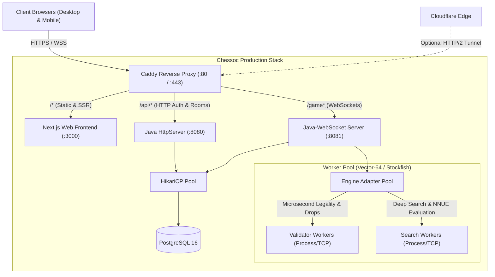

# Chessoc ♟️

> **Turnkey Infrastructure for Self-Hosted Chess Platforms, Custom Engines & Tournaments**

Chessoc is a production-ready, open-source platform designed to host your own private chess club, community platform, or custom engine tournament. Built on a resilient split architecture (Next.js web frontend, Java 17 high-throughput game server, PostgreSQL 16, and an isolated engine worker pool), Chessoc delegates 100% of chess semantics to an external engine process or service—allowing you to plug in any UCI-compliant engine or custom variant engine seamlessly.

---

## 🌟 Key Highlights

* **Plug-and-Play Engine Architecture**: Zero chess logic is hardcoded into the server. Plug in **Vector-64**, **Stockfish**, **Lc0**, or your own custom engine via subprocess pipes or TCP services (`CHESSOC_VALIDATOR_CMD` / `CHESSOC_SEARCH_CMD` / `CHESSOC_ENGINE_HOST`).
* **Two-Tier Engine Pooling**:
  * **Validator Pool**: Sub-millisecond stateless workers handling legality validation, legal move generation, capability-based security, and terminal detection without heavy NNUE search overhead.
  * **Search Pool**: Multithreaded workers budgeted for evaluation, principal variations, and AI opponents.
* **Full Variant Support**:
  * **Standard Chess** (FIDE rules, threefold repetition, 50-move rule, insufficient material).
  * **Crazyhouse** (captures enter player's reserve; in-hand piece drops).
  * **Bughouse** (2v2 dual-board team play with cross-board partner piece reserve routing and variant draw rules).
* **Complete Player Experience**:
  * Real-time WebSocket gameplay with low-latency clock synchronization and premoves.
  * Player profiles, rating tracking, and match history.
  * Social features: Friends system, direct messaging with unread notification bubbles, and challenge requests with custom time controls.
  * Live spectator mode and room broadcasting.
* **All-in-One VPS Deployment**: A single Docker container bundling PostgreSQL, the chess engine, Java backend, Next.js frontend, and Caddy with automatic Let's Encrypt HTTPS or Cloudflare Zero Trust tunneling.

---

## 🏛️ Architecture Overview



---

## 🚀 Quick Start (VPS Deployment)

Run the entire platform on your VPS with a single command. The container includes PostgreSQL, the Vector-64 engine, Next.js frontend, Java backend, and Caddy:

```bash
docker run -d \
  --name chessoc \
  --restart unless-stopped \
  -p 80:80 \
  -p 443:443 \
  -e DOMAIN="chess.yourdomain.com" \
  -v /opt/chess/data:/var/lib/postgresql/data \
  -v /opt/chess/secrets:/var/lib/chessoc \
  chessoc:latest
```

* Caddy will automatically provision and renew Let's Encrypt TLS certificates for `DOMAIN`.
* All database state, game archives, and tokens persist inside `/opt/chess`.

### Cloudflare Zero Trust Tunnel (Zero Open Inbound Ports)

If you use Cloudflare Tunnels (no open firewall ports required on your VPS):

```bash
docker run -d \
  --name chessoc \
  --restart unless-stopped \
  -e CLOUDFLARE_TUNNEL_TOKEN="your-cloudflare-tunnel-token" \
  -v /opt/chess/data:/var/lib/postgresql/data \
  -v /opt/chess/secrets:/var/lib/chessoc \
  chessoc:latest
```

---

## 🤖 Plugging in Your Own Chess Engine

Chessoc is engine-agnostic. By default, it bundles **Vector-64 v1.1.1** (supporting Standard, Crazyhouse, and Bughouse with embedded NNUE).

To plug in a custom binary or tournament engine:

### 1. Using a Local Process Binary
Mount your custom Linux engine binary and set the environment variables:

```bash
docker run -d \
  --name chessoc \
  -v /path/to/my-engine:/opt/my-engine:ro \
  -e CHESSOC_VALIDATOR_CMD="/opt/my-engine/engine-validator" \
  -e CHESSOC_SEARCH_CMD="/opt/my-engine/engine-all" \
  -e CHESSOC_VALIDATOR_WORKERS=4 \
  -e CHESSOC_SEARCH_WORKERS=2 \
  chessoc:latest
```

### 2. Using an External Network / TCP Engine Service
To connect to an engine running on a separate high-performance GPU/CPU machine or cluster:

```bash
-e CHESSOC_ENGINE_HOST="10.0.0.50" \
-e CHESSOC_ENGINE_PORT="9100"
```

The server communicates via standard UCI line protocol + JSON status extensions. See [doc/ENGINE_INTEGRATION.md](doc/ENGINE_INTEGRATION.md) for the complete protocol specification.

---

## 💻 Local Development & Quick Demo

### Windows Local Launcher
If you are developing locally on Windows with Docker Desktop:

```powershell
.\start-demo.cmd
```

* Starts PostgreSQL, Java backend, Next.js, and Caddy.
* Verifies engine readiness before reporting ready at `http://localhost/`.
* Automatically exposes an optional Cloudflare Quick Tunnel link for instant remote testing.

To stop the local stack:
```powershell
docker compose -f backend/docker-compose.yml down
```

---

## ⚙️ Configuration Reference

| Environment Variable | Default | Purpose |
| :--- | :--- | :--- |
| `CHESSOC_VALIDATOR_CMD` | `/opt/vector64/vector64-validator` | Path to the lean move validator binary |
| `CHESSOC_SEARCH_CMD` | `/opt/vector64/vector64-all` | Path to the search & evaluation engine binary |
| `CHESSOC_VALIDATOR_WORKERS` | `2` | Worker pool size for concurrent move validation |
| `CHESSOC_SEARCH_WORKERS` | `2` | Worker pool size for AI search and evaluation |
| `CHESSOC_ENGINE_HOST` | `""` | Optional TCP host for remote engine service |
| `CHESSOC_ENGINE_PORT` | `0` | Optional TCP port for remote engine service |
| `DOMAIN` | `""` | Public hostname; enables automatic Let's Encrypt HTTPS via Caddy |
| `CLOUDFLARE_TUNNEL_TOKEN` | `""` | Optional Cloudflare Named Tunnel token |
| `CHESSOC_DB_URL` | `jdbc:postgresql://127.0.0.1:5432/chessoc` | JDBC database connection string |
| `CHESSOC_DB_USER` | `chessoc` | Database user |
| `CHESSOC_DB_PASSWORD` | `chessoc` | Database password |
| `CHESSOC_TOKEN_SECRET` | *(auto-generated)* | Key for signing player JWT authentication tokens |

---

## 📁 Repository Structure

* `backend/` — Java 17 game server (Sun `HttpServer`, `Java-WebSocket`, HikariCP, PostgreSQL schema migrations, engine worker pool).
* `web/` — Next.js 16 frontend (React 19, Tailwind CSS, chess board canvas, premove handling, chat, profiles, and challenges).
* `deploy/` — Docker configurations, Caddy reverse proxy templates, system entrypoints, and VPS setup guides.
* `doc/` — Comprehensive architecture and engine integration contracts ([ENGINE_INTEGRATION.md](doc/ENGINE_INTEGRATION.md)).

---

## 📄 License & Attribution

Chessoc is distributed under the MIT License. Vector-64 engine binaries are bundled under GPL-3.0 compliance.
