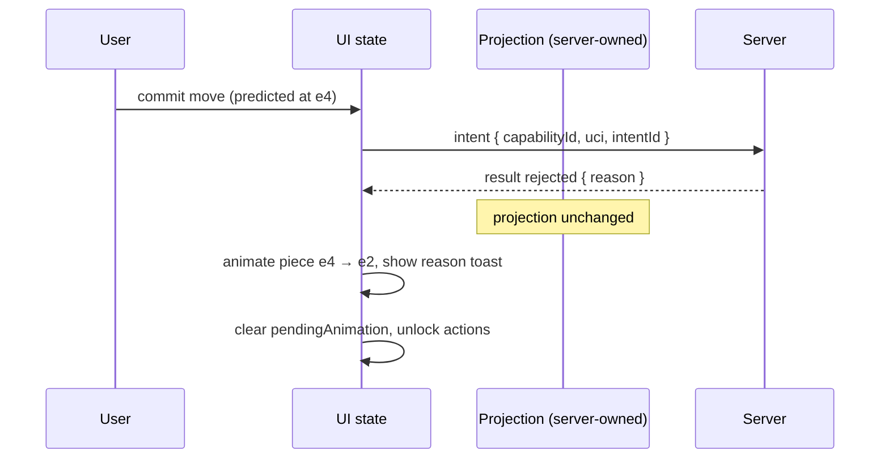
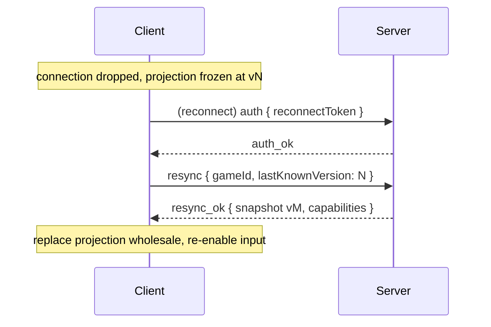

# Chessoc Frontend Architecture

## 1. Purpose and Scope

This document defines the architecture for the Chessoc **frontend clients**. It governs two production targets:

- The Next.js web client at [web/](web/)
- The Python/pygame desktop client at [python_gui/](python_gui/)

It defines client boundaries, the client-server contract *as the frontend depends on it*, and the rules that keep both clients as passive presentation layers. It does **not** design backend internals; where it describes protocol or server behavior, it describes what the frontend **expects**, not how the server implements it.

The overarching system rule from the platform architecture is unchanged: **the server is the only authority, and the client only renders state and sends actions.** This document exists so that future client code cannot silently reintroduce game rules, official clocks, or outcome adjudication.

Normative keywords **MUST**, **MUST NOT**, and **MAY** are used deliberately.

## 2. Frontend Invariants

These invariants are absolute. Any client change that violates one is a defect regardless of how convenient it is.

1. **The server is canonical.** The authoritative game state is whatever the server last sent. The client holds a *projection* of that state, never an independent copy that it evolves on its own.
2. **The client MUST NOT decide game rules.** It MUST NOT compute move legality, determine whose turn it is, switch turns, detect check/checkmate/stalemate/draws, compute captures or material scores, or produce an authoritative FEN. These are server outputs the client renders.
3. **The client MUST NOT own clocks.** Official time lives on the server. The client MAY interpolate a *display* between server clock samples (see §6) but MUST NOT adjudicate a flag/timeout.
4. **Rendering transformations are allowed.** Converting a server-provided FEN into square-to-piece placement, sorting captured pieces for display, or formatting a clock value are presentation transforms, not decisions, and are permitted.
5. **Authoritative projection and UI state are strictly separated.** Ephemeral presentation state (hover, selection, drag ghost, pending animation, modal open) MUST live in a separate store from the authoritative projection and MUST NOT be able to mutate it.
6. **Production frontend code MUST NOT import a chess rules engine** (e.g. `chess.js`). Legal move data comes only from server capabilities. This is enforced by lint (§14).

## 3. Two-Client Architecture

Both clients are first-class and independently replaceable. They share a single protocol contract and fixture set so they stay behaviorally equivalent.

```text
                    +--------------------------+
                    |   Shared protocol +      |
                    |   fixtures (schema,      |
                    |   message shapes,        |
                    |   scenario JSON)         |
                    +------------+-------------+
                                 |
             +-------------------+-------------------+
             |                                       |
   +---------v----------+                 +----------v---------+
   |  Next.js web client |                 |  Python desktop    |
   |  HTTPS (auth/lobby) |                 |  client (pygame)   |
   |  WSS  (live game)   |                 |  transport iface   |
   +---------+----------+                 +----------+---------+
             |                                       |
             +-------------------+-------------------+
                                 |
                    +------------v-------------+
                    |  Java Game Server (auth) |
                    |  or dev mock service     |
                    +--------------------------+
```

- **Web client** talks HTTPS for non-realtime operations (auth handshake, lobby, history) and an authenticated **WSS** connection for the live game protocol. Browsers cannot open raw TLS-over-TCP sockets, so WSS is the browser live transport.
- **Python client** speaks the same application-level envelopes through a `Transport` interface. In development it uses a WebSocket transport; in production it MAY use the platform's TLS-wrapped TCP live channel. The message contract is identical either way.
- **Conformance:** both clients MUST pass the same shared contract tests (§14) against the same fixtures, so a scenario that behaves one way in one client behaves identically in the other.

## 4. State Model

The client maintains four separate concerns. They MUST NOT be collapsed into one blob.

### 4.1 Auth state

Tracks whether the user is authenticated and holds a live connection ticket. Transitions only in response to auth-server (HTTPS) results. No optimistic authentication.

States: `INIT → LOGGED_IN → TICKET_ISSUED → CONNECTED` (plus `FAILED`).

### 4.2 Connection state

Tracks the live transport lifecycle, independent of game content.

States: `DISCONNECTED → CONNECTING → CONNECTED → RECONNECTING → FAILED`. Reconnection uses bounded exponential backoff and, on success, issues a `resync` (§8).

### 4.3 Authoritative game projection

A monotonic, server-owned snapshot. Mutated **only** by `snapshot`, `result` (accepted/stale), and `resync_ok` messages. Carries a `version` that never decreases; any message with `version < current` is ignored.

Fields: `gameId`, `version`, `initialFen`, `fen`, `sideToMove`, `moves[]`, `clockSample`, `result?`, `whitePlayerId`, `blackPlayerId`, `capabilities`.

### 4.4 Ephemeral presentation (UI) state

Local, volatile, lost on refresh - and that is acceptable. Never authoritative.

Fields: `selectedSquare`, `legalTargets` (sourced from a capability, not computed), `pendingIntentId`, `pendingAnimation`, `errorToast`, `modalOpen`, `dragGhost`.

### 4.5 Ownership table

| Field / concern            | Owner                | Client MAY                          | Client MUST NOT                          |
|----------------------------|----------------------|-------------------------------------|------------------------------------------|
| `fen` / board position     | Server projection    | Render it, animate transitions      | Mutate it locally, derive next position  |
| `sideToMove`               | Server projection    | Display whose turn                  | Compute or switch it                     |
| Legal move targets         | Server (capability)  | Highlight them                      | Compute them from board                  |
| `moves[]` history          | Server projection    | Render list                         | Append a move before server confirms     |
| Official clock             | Server sample        | Interpolate the *display*           | Adjudicate timeout, switch active side   |
| Captures / material score  | Server projection    | Render provided values              | Recompute from board diff                |
| Game result / winner       | Server projection    | Show result UI                      | Detect checkmate/stalemate/draw          |
| Selection / hover / drag   | UI state             | Own fully                           | Treat as game state                      |
| Pending predicted position | UI state             | Show optimistically (§5)            | Commit to projection                     |
| Session / capability token | Server-issued        | Present it on requests              | Fabricate, mutate, or reuse a spent one  |

## 5. Smooth UX Without Surrendering Authority

The client must feel instant while never letting a local prediction become truth. This is achieved by combining server pre-authorization with local visual prediction and server reconciliation.

### 5.1 Pattern

1. **Pre-authorization.** With each projection the server sends the set of currently-permitted actions as **capabilities**. Each legal move has its own `move` capability containing one exact UCI (§7). The client groups these capabilities by source square to derive instant destination highlights - with no round trip and no rules engine.
2. **Immediate local feedback.** Selecting a piece, showing legal targets, dragging a ghost, and snapping a piece to a dropped square are all UI-state changes that happen at input time, with zero latency.
3. **Predicted position is presentation-only.** When the user commits an action, the piece is shown at its destination as `pendingAnimation` in UI state, and an `intent` is sent. The authoritative projection is **not** touched.
4. **Reconciliation on result.**
   - **Accepted:** the server sends the new snapshot. The projection advances. Because the piece was already shown at the destination, there is no visible jump - the prediction simply becomes confirmed.
   - **Rejected / stale:** the projection is unchanged (or replaced by the server's current snapshot). The predicted piece animates back to its confirmed square, and the rejection reason is surfaced.
5. **Local pre-check before send.** If the user drops on a square not present in the capability's legal set, the client MUST snap back immediately without sending an intent. This is a UI reflection of server-provided data, not a rules decision.

### 5.2 Concurrency guard

By default the client allows **one pending domain action per game** at a time. A second action MUST NOT be predicted or sent until the first resolves (or times out and reconciles). This prevents speculative chains where prediction #2 depends on the unconfirmed result of prediction #1.

### 5.3 Opponent moves

When a new snapshot arrives for the opponent's move, the client animates the moved piece from its previous square (known from the prior projection) to its new square, then settles on the new `fen`.

### 5.4 Accepted-move sequence

```mermaid
sequenceDiagram
    participant U as User
    participant UI as UI state
    participant P as Projection (server-owned)
    participant S as Server
    U->>UI: drag e2 → drop e4 (in capability legal set)
    UI->>UI: show piece at e4 (pendingAnimation), lock further actions
    UI->>S: intent { capabilityId, uci: e2e4, intentId }
    S-->>UI: receipt { intentId }
    S-->>P: result accepted { snapshot v+1, new capabilities }
    P->>UI: projection advances; clear pendingAnimation
    Note over UI: piece already at e4 → no visible jump
```

### 5.5 Rejected-move sequence



## 6. Clock Presentation

1. The server sends periodic **clock samples**: `{ whiteRemainingMs, blackRemainingMs, activeSide, serverTimestamp }`. These are canonical.
2. The client records each sample with the local monotonic time at which it was received.
3. Between samples, the display MAY interpolate: for the `activeSide`, subtract elapsed local monotonic time from the last sampled remaining time. This produces a smooth ticking display.
4. Every new server sample **corrects** the display; the client blends toward the server value over a short interval (e.g. ~300ms) rather than snapping, to avoid visible jitter.
5. Interpolation is display-only. The client MUST NOT declare a timeout, switch `activeSide`, or trigger any game-over UI from local time. Only a server `result` ends a game.
6. If no sample arrives for a staleness threshold (e.g. >5s) or the connection drops, the clock display MUST show a stale/disconnected indicator and stop implying precision.

## 7. Capability-Gated Actions

Every action the player can take is authorized by a single-use **capability** issued by the server.

### 7.1 Capability shape

A capability is bound to: `sessionId`, `gameId`, `gameVersion`, `kind`, exact permitted `params`, `expiresAt`, and an opaque server `signature`. The client treats `signature` as an opaque token - it never inspects or forges it.

- **Single-use / bijective:** one capability authorizes exactly one action instance with exactly one parameter set. For moves, `e2e4` and `e2e3` are two distinct capabilities. Once consumed (or once a newer projection arrives), it is invalid.
- **Version-bound:** the client MUST NOT send an intent whose capability `gameVersion` differs from the current projection `version`.
- **Expiry:** an expired capability MUST NOT be used; the UI reflects it as unavailable.

### 7.2 Action catalog (v1)

|kind|exact capability params|intent params|UI surface|
|---|---|---|---|
|`move`|`{ uci }`|`{}`|Board drag/click; UCI suffix covers promotion|
|`resign`|`{}`|`{}`|Resign button|
|`offer_draw`|`{}`|`{}`|Offer-draw button|
|`respond_draw`|`{ accept: bool }`|`{}`|Accept/Decline prompt (one per choice)|
|`rematch`|`{ opponentId }`|`{}`|Rematch button (game-over screen)|

### 7.3 Promotion

Promotion is **not** a separate action kind. When a pawn can promote, the server issues separate `move` capabilities for each promotion choice, each with a distinct `uci` (e.g. `{ uci: "a7a8q" }`, `{ uci: "a7a8r" }`). When multiple promotion capabilities exist from the same source square, the client shows a picker. The user selects, and the client sends the correct intent. No promotion logic is computed client-side.

### 7.4 Invalidation and spectators

- Whenever a newer projection (higher `version`) arrives, **all** previously held capabilities are discarded and replaced by the new set.
- **Spectators** receive no interactive capabilities. Their board renders read-only; input handlers are disabled, not merely hidden.
- **Unknown capability kinds** (a kind the client does not implement) MUST be rendered as an inert/disabled affordance, never silently executed.

## 8. Protocol Contract

This is the frontend's view of the wire contract. The server owns the authoritative definition; the client depends on these shapes.

### 8.1 Envelope

Every live message is a versioned JSON envelope:

```json
{ "v": [1, 0], "type": "snapshot", "payload": { } }
```

`v` is `[major, minor]`. On connect the server states its version; the client MUST refuse (and surface an error) on an incompatible major version rather than guessing.

### 8.2 Message catalog

| type           | direction | payload (summary)                                                        |
|----------------|-----------|--------------------------------------------------------------------------|
| `auth`         | client→   | `{ ticket, reconnectToken?, lastKnownVersion? }`                         |
| `auth_ok`      | →client   | `{ sessionId, playerId, connectionId }`                                  |
| `auth_err`     | →client   | `{ reason }`                                                             |
| `snapshot`     | →client   | `{ snapshot: GameSnapshot, capabilities: Capability[] }`                 |
| `capabilities` | →client   | `{ capabilities: Capability[] }`                                         |
| `intent`       | client→   | `{ intentId, capabilityId, params, clientTimestamp }`                    |
| `receipt`      | →client   | `{ intentId, serverTimestamp }` (acknowledgement only, not a verdict)    |
| `result`       | →client   | `{ disposition: accepted\|rejected\|stale, intentId, reason?, snapshot?, capabilities? }` |
| `clock`        | →client   | `{ whiteRemainingMs, blackRemainingMs, activeSide, serverTimestamp }`    |
| `resync`       | client→   | `{ gameId, lastKnownVersion }`                                           |
| `resync_ok`    | →client   | `{ snapshot: GameSnapshot, capabilities: Capability[] }`                 |
| `error`        | →client   | `{ code, message }`                                                      |
| `ping`/`pong`  | both      | `{}` (keepalive)                                                         |

### 8.3 Semantics the client MUST honor

- **Intent IDs & dedup:** every intent carries a client-generated `intentId`. If a `receipt` does not arrive within a timeout, the client MAY retry with the **same** `intentId`; the server deduplicates. `result` handling MUST be idempotent.
- **Monotonic version:** ignore any snapshot/result whose `version` is older than the current projection.
- **Stale handling:** a `stale` disposition means the client's action referenced an outdated version; the client adopts the server snapshot attached to the result and discards its predicted move.
- **Reconnect/resync:** on reconnect the client sends `resync` with `lastKnownVersion`; the server replies with a full `resync_ok`. The client replaces its projection wholesale - no local merge.
- **Full snapshots first:** correctness is defined against full snapshots. Delta/partial-update messages MAY be added later, but only once full-snapshot behavior is proven and tested.



## 9. Authentication and Token Handling

The frontend **consumes** credentials; it never authenticates or authorizes itself. All authorization decisions are the server's.

### 9.1 Web (browser)

- Login happens over HTTPS. The server sets an **HttpOnly, Secure, SameSite** session cookie. The client JavaScript never reads a long-lived credential.
- To open the WSS connection, the client requests a **short-lived, single-use ticket** over HTTPS (authorized by the cookie) and presents it in the first `auth` envelope. The ticket is consumed on use.
- No durable token is placed in `localStorage`/`sessionStorage`. Session continuity is the cookie plus fresh tickets.

### 9.2 Python (desktop)

- Credentials/tokens are held behind a **secure-store abstraction** (`auth_store`) with platform backends (OS keychain/secret service) and an encrypted-file fallback.
- The client MUST NOT hard-depend on WinAPI/hardware fingerprinting; the store is an interface so identity can be a server-issued signed token on any platform.
- A short-lived access token authorizes the live connection; an opaque refresh token (in the secure store) renews it.

### 9.3 Reconnect

Both clients keep an opaque one-use `reconnectToken` from the current session to rejoin without a full re-login within the server's grace window. It is presented in `auth` on reconnect and is not a substitute for the session credential.

## 10. Frontend Module Boundaries

Each client is layered so that authority cannot leak into presentation.

```text
  protocol        types + envelope encode/decode + version check
     |            (pure, no I/O, no rendering)
     v
  transport       WSS / TCP / mock; sends & receives envelopes
     |            (no game logic, cannot mutate rendered state directly)
     v
  store/reducer   auth + connection + projection + UI state
     |            (pure reducer; projection mutated only by server messages)
     v
  view-model      adapts projection + UI state into render-ready props
     |            (FEN → piece placement, capability → legal targets)
     v
  components       presentational only (board, pieces, clocks, modals)
```

Rules:

- Presentation components **MUST NOT** import the transport directly; they dispatch intents through the store and read from the view-model.
- The transport **MUST NOT** write rendered state directly; it feeds envelopes into the reducer.
- The reducer is a **pure function**; it MUST NOT call a rules engine or compute FEN.
- Production code **MUST NOT** import `chess.js` or any rules engine (enforced in §14).

### 10.1 Web layout (target)

- `web/src/lib/protocol.ts` - envelope + message types, version check.
- `web/src/lib/transport.ts`, `web/src/lib/mock-transport.ts` - live + dev transports behind one interface.
- `web/src/lib/store.ts` (reducer + state machine) - auth/connection/projection/UI.
- `web/src/lib/view-model.ts` - FEN→pieces, capability→targets adapters.
- `web/src/hooks/use-game.ts` - wires transport ↔ store, exposes state + `sendIntent` (with local prediction).
- `web/src/components/ui/*` - presentational components (see §15).

### 10.2 Python layout (target)

- `chessoc_gui/protocol.py` - dataclasses mirroring the envelope/messages.
- `chessoc_gui/transport.py` (interface) + `wss_transport.py` / `tcp_transport.py` / `mock_transport.py`.
- `chessoc_gui/state.py` - projection + reducer + connection/auth state.
- `chessoc_gui/auth_store.py` - secure token storage abstraction.
- Preserved presentation modules: `board_view.py`, `fen.py`, `controls.py`, `theme.py`.

## 11. Temporary Mock API

Until the real server transport exists, both clients develop and test against a standalone mock.

- **Separate process** at [mock-service/](mock-service/); it is **not** part of either client's production bundle.
- Implements the **same protocol** (§8) over HTTPS + WSS: auth handshake, snapshots, capabilities, intents, receipts, results, clock pushes, resync.
- **Deterministic scenarios** driven by shared fixtures: accepted moves, rejections (with reasons), stale-version responses, disconnect/reconnect, promotion, and spectator (no capabilities).
- It **MUST NOT** return generic booleans or make chess decisions on the client's behalf; it returns typed snapshots and dispositions exactly as the real server would.
- **Dev-only activation:** the web client selects the mock transport only under an explicit env flag (e.g. `NEXT_PUBLIC_MOCK_API`); the Python client only under an explicit flag/env. The mock MUST NOT be the production default, and its modules MUST be excluded from production configuration.
- **Shared fixtures** live under [fixtures/](fixtures/) and are consumed by the mock and by both client test suites, keeping contract behavior identical.

## 12. Failure and Recovery UX

| Situation                    | Required client behavior                                                                 |
|------------------------------|------------------------------------------------------------------------------------------|
| Receipt lost                 | Retry the same `intentId` after timeout; server dedups; UI still shows pending.          |
| Duplicate send               | Idempotent `result` handling; no double application.                                     |
| Rejection                    | Projection unchanged; predicted piece animates back; show server `reason`.               |
| Stale capability/version     | Adopt server snapshot from the `stale` result; discard predicted move and old caps.      |
| Capability expired           | Reflect action as unavailable before send; never send an expired capability.             |
| Disconnect                   | **Freeze** the last confirmed projection; disable new intents; show reconnecting overlay.|
| Reconnect                    | `resync`; replace projection wholesale; re-enable input.                                 |
| Unsupported capability kind  | Render inert/disabled; never execute.                                                    |
| Malformed / bad-version msg  | Drop it, surface a non-fatal error; do not corrupt projection.                           |

While disconnected the board remains visible at its last confirmed state, but it is read-only - no prediction is allowed without a live, authorized connection.

## 13. Accessibility and Responsive UX

- **Input parity:** click/tap-to-move and drag-to-move MUST both be supported and reach the same intent path.
- **Keyboard:** squares are focusable and selectable by keyboard; promotion is operable without a pointer.
- **Reduced motion:** honor the OS/browser reduced-motion preference with an instant (non-animated) reconciliation path.
- **Touch:** interactive targets ≥ 44px; the board scales responsively without breaking square math.
- **Focus & status:** visible focus indicators; game status, check, and results are announced to assistive tech (e.g. a live region), sourced from server state.

## 14. Testing and Enforcement

- **Shared contract tests:** both clients run the same fixture-driven scenarios and MUST produce equivalent state transitions.
- **Authority-negative tests (required):**
  - The projection does **not** change before an `accepted` result (no board commit on send).
  - A `rejected` result leaves the confirmed state intact and reconciles the predicted piece.
  - A `stale` result replaces the projection with the server snapshot; the local prediction is dropped.
  - A newer snapshot invalidates all prior capabilities.
  - Reconnect replaces the projection wholesale (no merge).
  - The clock never triggers timeout/turn-switch/game-over locally.
- **Import guard:** a lint rule forbids importing `chess.js` (or any rules engine) from production frontend code; violations fail CI.
- **Web:** unit tests for reducer/view-model, integration against the mock transport, and end-to-end coverage of move/reject/reconnect/promotion/clock-render.
- **Python:** headless (offscreen surface) tests for reducer, transport, and FEN rendering.

## 15. Migration Map From Current Code

### 15.1 Web - remove authority, keep presentation

Authoritative logic to **remove** from [web/src/app/(game)/room/[id]/page.tsx](web/src/app/(game)/room/[id]/page.tsx):

- The `chess.js` `Chess` instance and all rule calls (`.move()`, `.moves()`, `.turn()`, `.isGameOver()`, `.isCheckmate()`, etc.).
- The local `setInterval` clock countdown.
- Client-side captured-piece and material computation.
- Client-side game-over reason/winner derivation and local restart.

Replace with: a `use-game` hook exposing the server projection, capabilities, and `sendIntent` (with local prediction per §5).

[web/src/components/ui/Board.tsx](web/src/components/ui/Board.tsx): stop taking a `Chess` object and calling `game.moves()`; take a **view-model** (`fen`→pieces, server-provided `legalTargets`, `pendingAnimation`, `interactive`). Remove the `chess.js` import.

**Preserve** the reusable presentation: Framer Motion piece animation and drag in [web/src/components/ui/Piece.tsx](web/src/components/ui/Piece.tsx) (add `interactive`/`pending` and conditional snap-back), [web/src/components/ui/MoveHistory.tsx](web/src/components/ui/MoveHistory.tsx) and [web/src/components/ui/CapturedPieces.tsx](web/src/components/ui/CapturedPieces.tsx) (already pure presentational - fed by server data), and the landing/room styling. Rework [web/src/components/ui/GameOverModal.tsx](web/src/components/ui/GameOverModal.tsx) to render the server result and a rematch capability instead of a local restart.

### 15.2 Python - remove scripted authority, keep the renderer

Remove from [python_gui/chessoc_gui/app.py](python_gui/chessoc_gui/app.py): the authoritative fields and scripted flow (`current_fen`/`current_board` as the source of truth, hardcoded clocks, `interaction_stage`/`_expected_player_action`, and the pre-baked `sequence.py`/`models.py` move outcomes). These move to dev fixtures and are replaced by transport + reducer.

**Preserve:** [python_gui/chessoc_gui/board_view.py](python_gui/chessoc_gui/board_view.py) (pixel/square mapping, drawing, animation ghost), the animation interpolation currently in `app.py`, [python_gui/chessoc_gui/fen.py](python_gui/chessoc_gui/fen.py) (FEN→placement is a rendering transform), [python_gui/chessoc_gui/controls.py](python_gui/chessoc_gui/controls.py), and [python_gui/chessoc_gui/theme.py](python_gui/chessoc_gui/theme.py).

## 16. Invariants Checklist and Phased Rollout

### 16.1 Pre-merge checklist (every client change)

- [ ] No rules engine imported in production code.
- [ ] Projection mutated only by `snapshot` / `result` / `resync_ok`.
- [ ] Legal targets sourced from capabilities, not computed.
- [ ] No local clock adjudication; clock is display-only.
- [ ] Predicted position lives only in UI state; reconciled on result.
- [ ] Capabilities are single-use and version-bound; stale ones discarded on new snapshot.
- [ ] Disconnect freezes state and disables intents; reconnect replaces projection wholesale.

### 16.2 Phased rollout

1. **Shared contract** - protocol types + fixtures.
2. **Mock service** - deterministic scenarios over HTTPS/WSS.
3. **Web transport + reducer** - projection/UI separation, prediction/reconciliation.
4. **Web UI** - board/pieces/clocks/modals on the view-model; `chess.js` removed.
5. **Python transport + reducer** - same contract, secure token store.
6. **Python UI** - renderer wired to projection; scripted authority removed.
7. **Auth + reconnect hardening** - tickets, resync, edge cases, accessibility, tests.

